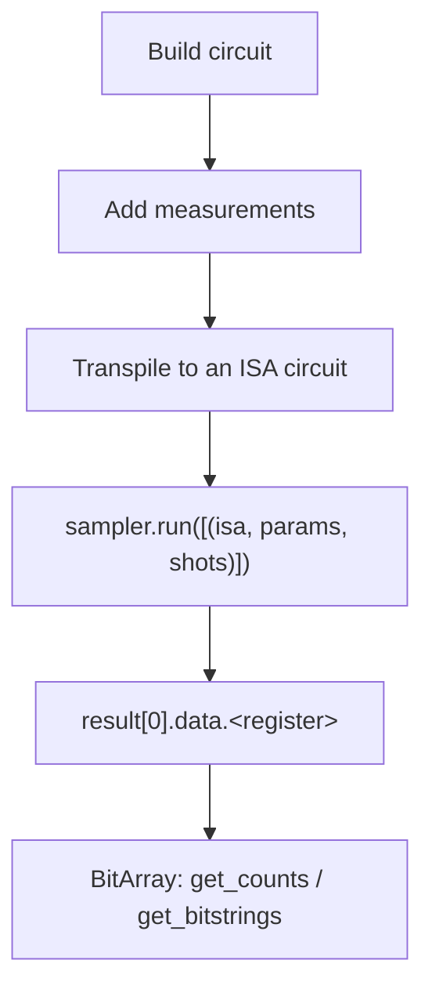
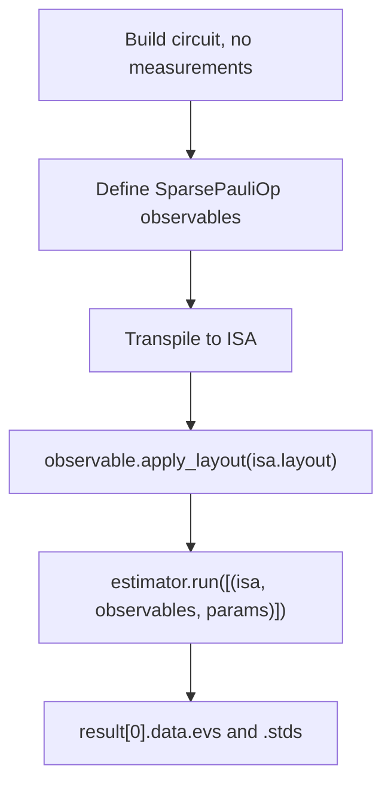
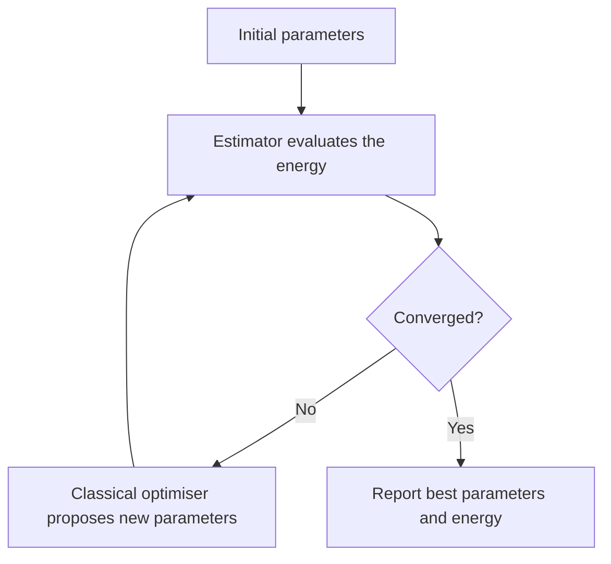

# Circuit Diagrams and Core Concepts

Short notes on the ideas the practice questions lean on most. Diagrams use Mermaid and plain text so they render on GitHub.

## 1. Bell state

Start in $|00\rangle$, apply H to qubit 0, then CX with qubit 0 as control.

```text
q0: |0> ── H ──●──
               │
q1: |0> ───────X──
```

$$
|00\rangle \xrightarrow{H_0} \frac{|00\rangle+|10\rangle}{\sqrt{2}} \xrightarrow{CX_{0,1}} \frac{|00\rangle+|11\rangle}{\sqrt{2}}
$$

```python
from qiskit import QuantumCircuit
from qiskit.primitives import StatevectorSampler

qc = QuantumCircuit(2)
qc.h(0)
qc.cx(0, 1)
qc.measure_all()

counts = StatevectorSampler().run([qc]).result()[0].data.meas.get_counts()
print(counts)   # roughly {'00': 512, '11': 512}
```

You only ever see `00` or `11`, about half the time each. The split won't be exactly 512/512, because 1024 shots is still a finite sample.

## 2. Bit ordering

Qiskit is little-endian: **qubit 0 is the rightmost character** in a bitstring or Pauli label.

```text
bitstring  '0 0 1'          Pauli label  'X Y Z'
            │ │ └─ qubit 0               │ │ └─ qubit 0
            │ └─── qubit 1               │ └─── qubit 1
            └───── qubit 2               └───── qubit 2
```

More practice questions hinge on this than on any other single idea. When in doubt, check: `Pauli('XYZ')[0]` returns `Pauli('Z')`.

## 3. Sampler workflow



Use the Sampler when you want the bitstrings themselves. The register name in step E is `meas` if you used `measure_all()`, and `c` if you built the circuit as `QuantumCircuit(n, m)`.

## 4. Estimator workflow



Use the Estimator when you want a number such as $\langle Z \rangle$, $\langle ZZ \rangle$ or an energy. Step D is the one people forget, and without it the observable doesn't line up with the physical qubits the router chose.

## 5. PUB shapes and broadcasting

A PUB is one unit of work for a primitive:

| Primitive | PUB layout |
|---|---|
| Sampler | `(circuit, parameter_values, shots)` |
| Estimator | `(circuit, observables, parameter_values, precision)` |

The last axis of `parameter_values` holds the circuit's parameters, and everything before it is the PUB's shape. Observables and parameter sets broadcast together using NumPy rules, so observables of shape `(3, 1)` with 20 parameter sets give `evs` of shape `(3, 20)`.

## 6. Hybrid (variational) loop



This is the shape of VQE and QAOA. Because each step depends on the last, it runs well inside a **Session**. For independent jobs, use **Batch** instead.

## 7. Things that changed in Qiskit 2.x

| Old way | Qiskit 2.x |
|---|---|
| `execute(qc, backend)` | Transpile to ISA, then `SamplerV2` / `EstimatorV2` |
| `qiskit.primitives.Sampler` / `Estimator` (V1) | `StatevectorSampler` / `StatevectorEstimator` locally |
| `qc.x(1).c_if(cr, 1)` | `with qc.if_test((cr, 1)): qc.x(1)` |
| `result.quasi_dists` | `result[0].data.meas.get_counts()` |
| `RealAmplitudes(...)` class | `real_amplitudes(...)` function |
| Default `optimization_level=1` | Default is now `2` |

## 8. Quick reference

| Concept | Meaning |
|---|---|
| ISA circuit | Uses only the backend's native gates and respects its connectivity. IBM Runtime only accepts these |
| Layout | Which physical qubit each of your virtual qubits landed on (`isa.layout`) |
| Shot | One run of the circuit, giving one bitstring |
| Session | Keeps the QPU available to you between dependent jobs |
| Batch | Groups independent jobs |
| Resilience level | Estimator only: 0 = none, 1 = readout (TREX), 2 = + ZNE |
| OpenQASM 3 | Text format that, unlike QASM 2, can express `if`, loops and `input` parameters |
